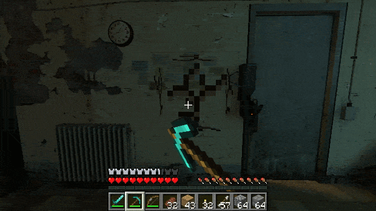

# HalfCraft 2

> **This is the `cooptest` branch:** unfinished co-op work (two players on one Half-Life 2 map, sharing one
> Minecraft world). It is paused and not playable yet. For the game, use `main` and the
> [latest release](https://github.com/prolert/HalfCraft2/releases/latest).

Half-Life 2 played by Minecraft's rules. A real Minecraft runs hidden in the background and handles your
movement, inventory, blocks and combat. Half-Life 2 draws the world around you and runs its maps, NPCs and story.

**You can break Half-Life 2's own world block by block:** take a pickaxe to a wall, floor or ceiling and dig
straight through it. The idea comes from [SkyCraft](https://github.com/chasmlol/SkyCraft), the mod that does the
same with Skyrim and Minecraft.

  

## What you can do

- Break Half-Life 2's walls, floors and ceilings and walk through the holes. Digging needs the Half-Life 2:
  Deathmatch engine; see Requirements.
- Build anything on Half-Life 2's maps with Minecraft blocks, and light City 17 with torches.
- Fight the Combine with a diamond sword, a bow or Half-Life's own weapons, which sit in your hotbar.
- Play all of Half-Life 2, Episode One, Episode Two and Lost Coast from one New Game menu, each with its own
  character animations and cutscenes.
- Load a Half-Life save and the Minecraft blocks and inventory go back to that moment too.
- Use the launcher in English or Russian.

## Requirements

- Windows 10 or 11, 64-bit.
- [Half-Life 2](https://store.steampowered.com/app/220/) on Steam. Episode One and Episode Two come with it.
- [Half-Life 2: Deathmatch](https://store.steampowered.com/app/320/) on Steam, optional. Its 64-bit engine is
  the only one where digging through walls works.
- A Microsoft account that owns Minecraft: Java Edition.
- About 1 GB of free space. Minecraft and Java download on first launch.

## Install and play

1. Download `HalfCraft-<version>.zip` from [Releases](https://github.com/prolert/HalfCraft2/releases/latest).
2. Unpack it anywhere, for example `C:\Games\HalfCraft`. A path with Latin letters only is safest.
3. Run `HalfCraft EN.cmd`, or `HalfCraft RU.cmd` for Russian.
   - If Windows warns about an unknown publisher, click **More info**, then **Run anyway**.
   - If you have Half-Life 2: Deathmatch, HalfCraft asks which engine to use. Pick Deathmatch to dig.
4. The first time, Prism Launcher opens: sign in with your Microsoft account. After that it stays signed in.
5. Wait for Minecraft to download and connect. The line at the top of the screen shows progress. Then start a
   New Game or load a save.

**Update:** unpack the new zip over the old folder. Your saves and Minecraft sign-in stay.
**Uninstall:** delete the folder. Your Steam games aren't changed.

## Controls

Minecraft's own keys (WASD, mouse, E for inventory, 1–9, F5 for the camera), plus:

| Key | Action |
|---|---|
| Shift | Crouch. Crouch in the air to jump into vents. |
| G | Use: doors, buttons, chargers, ladders; pick up objects |
| Mouse, while holding an object | Left button throws it, right button drops it |
| V | Flashlight |
| Esc | Half-Life menu: save, load, options, quit |
| F6 / F9 | Quick save / quick load |

## Troubleshooting

- **Stuck on "Sign in to Minecraft in the Prism Launcher window":** switch to Prism with Alt+Tab and sign in.
- **"Minecraft isn't running":** quit and start HalfCraft again.
- **"Only one instance of the game can be running":** close any other Source game first.
- **A character looks different:** a Steam Workshop addon that replaces characters can override HalfCraft's
  models. Unsubscribe from it.
- **Logs:**
  - Half-Life: `game-hl2dm\console.log` (or `game-hl2\console.log`).
  - Minecraft: `minecraft\Prism\instances\HalfCraft\.minecraft\logs\latest.log`.
  - Prism Launcher: `minecraft\Prism\logs`.

## Known limits

- Single player only. Co-op is planned: the first parts are on this branch, and work is paused.
- Blended grass and sand ground isn't cut by digging. Walls, floors, ceilings and rock are.
- Near holes, some distant parts of a map can briefly fail to draw.

## Building from source

See [DEVELOPMENT.md](DEVELOPMENT.md).

## Credits

- [HalfCraft](https://github.com/whiskydumb/halfcraft) by whisky, the mod HalfCraft 2 is built on.
- [SkyCraft](https://github.com/chasmlol/SkyCraft) by chasmlol (Skyrim + Minecraft). The digging idea and much of
  the design come from it.
- [hl2dm-sp](https://github.com/hardlightbridge/hl2dm-sp): the Half-Life 2 campaigns on the 64-bit engine.
- Valve's Source SDK 2013, [Fabric](https://fabricmc.net/) and [Prism Launcher](https://prismlauncher.org/).
  See [THIRD-PARTY-NOTICES.md](THIRD-PARTY-NOTICES.md).
- **AI disclosure:** HalfCraft 2's changes were written with [Claude Code](https://claude.com/claude-code)
  (Claude Opus 5.5 and Claude Sonnet 5.5), directed and play-tested by prolert. These changes cover digging
  through walls, the rendering fixes, the campaign animations, the launchers and the co-op groundwork. No
  AI-generated art or audio is included.

## License

MIT, see [LICENSE](LICENSE). HalfCraft 2 isn't affiliated with or endorsed by Valve, Mojang or Microsoft. You
need your own copies of Half-Life 2 and Minecraft.
